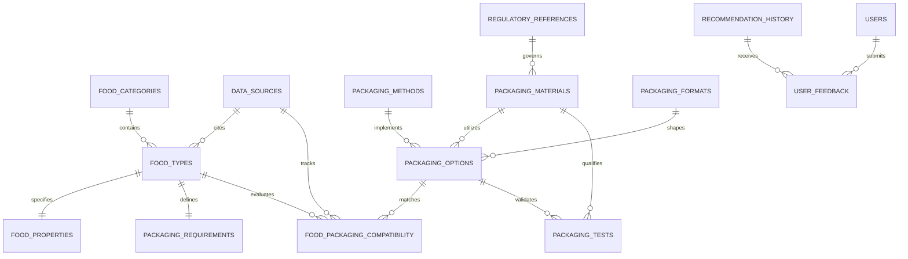

# Database Schema Documentation: Food Packing Solutions AI

## Overview
Food Packing Solutions AI utilizes a normalized relational database design supporting PostgreSQL in production and SQLite in local development environments. The schema comprises 15 relational tables designed with strict primary keys, foreign keys, indexes, timestamps, and data provenance references.

---

## Entity Relationship Summary

---

## 15 Relational Tables

### 1. `food_categories`
Stores standardized food groupings with display properties and typical spoilage vectors.
- `id`: INTEGER PRIMARY KEY AUTOINCREMENT
- `name`: VARCHAR(100) UNIQUE NOT NULL (e.g., Prepared meal, Produce, Dairy, Bakery)
- `slug`: VARCHAR(100) UNIQUE NOT NULL
- `description`: TEXT
- `icon`: VARCHAR(100)
- `typical_spoilage_risks`: TEXT
- `display_order`: INTEGER DEFAULT 0
- `created_at`: DATETIME

### 2. `food_types`
Master catalogue of individual food products (initial 103 items seeded from `food_packing_ai_dataset.xlsx`).
- `id`: INTEGER PRIMARY KEY AUTOINCREMENT
- `code`: VARCHAR(50) UNIQUE NOT NULL (e.g., F001, F002)
- `name`: VARCHAR(200) NOT NULL INDEX
- `category_id`: INTEGER REFERENCES `food_categories(id)`
- `physical_state`: VARCHAR(100) (Solid, Liquid, Powder, Granular, Prepared Meal, Fresh Produce, Fresh Meat / Seafood, Frozen)
- `description`: TEXT
- `image_url`: VARCHAR(500)
- `validation_priority`: VARCHAR(50) (High, Medium, Low)
- `data_source_id`: INTEGER REFERENCES `data_sources(id)`
- `is_active`: BOOLEAN DEFAULT TRUE
- `created_at`: DATETIME
- `updated_at`: DATETIME

### 3. `food_properties`
Physicochemical characteristics and environmental sensitivities.
- `id`: INTEGER PRIMARY KEY AUTOINCREMENT
- `food_id`: INTEGER UNIQUE REFERENCES `food_types(id)` ON DELETE CASCADE
- `moisture_level`: VARCHAR(50) (High, Medium, Low)
- `moisture_content_pct`: FLOAT (preserved as unknown if unverified)
- `water_activity_aw`: FLOAT (aw scale 0.00 to 1.00)
- `oil_fat_content`: VARCHAR(50) (High, Medium, Low)
- `ph_level`: FLOAT (acid vs low-acid barrier impact)
- `oxygen_sensitivity`: VARCHAR(50) (High, Medium, Low)
- `light_sensitivity`: VARCHAR(50) (High, Medium, Low)
- `aroma_sensitivity`: VARCHAR(50) (High, Medium, Low)
- `respiration_rate`: VARCHAR(50) (High, Medium, Low, None)
- `spoilage_risk`: VARCHAR(50) (High, Medium, Low)
- `storage_temperature`: VARCHAR(100) (Ambient, Refrigerated 0-4°C, Frozen -18°C, Hot Holding)
- `target_shelf_life_note`: VARCHAR(255)
- `storage_handling_note`: TEXT
- `spoilage_mechanisms`: TEXT

### 4. `packaging_methods`
Repository of the 16 core packaging methods/processes. Explicitly flags process vs material.
- `id`: INTEGER PRIMARY KEY AUTOINCREMENT
- `code`: VARCHAR(50) UNIQUE NOT NULL (METH01 to METH16)
- `name`: VARCHAR(200) NOT NULL
- `category`: VARCHAR(100) (Atmospheric Control, Thermal Sterilization, Rigid, Flexible, Active/Smart, Bio-Based, Cold Chain, Circular)
- `how_it_works`: TEXT NOT NULL
- `food_applications`: TEXT NOT NULL
- `food_protection_mechanism`: TEXT NOT NULL
- `advantages`: TEXT NOT NULL
- `limitations`: TEXT NOT NULL
- `cost_category`: VARCHAR(50) (Low, Moderate, High, Capital-Intensive)
- `environmental_considerations`: TEXT
- `equipment_requirements`: TEXT
- `storage_transport_suitability`: TEXT
- `safety_validation_requirements`: TEXT
- `is_process_vs_material`: BOOLEAN DEFAULT TRUE

### 5. `packaging_materials`
Polymer and substrate database (20 initial materials from dataset).
- `id`: INTEGER PRIMARY KEY AUTOINCREMENT
- `code`: VARCHAR(50) UNIQUE NOT NULL (M001 to M020)
- `name`: VARCHAR(200) NOT NULL (Glass, PET, HDPE, PP, LDPE, Paperboard, Aluminium foil, EVOH, etc.)
- `format_type`: VARCHAR(100)
- `moisture_barrier`: VARCHAR(50) (Ultra-High, High, Medium, Low)
- `oxygen_barrier`: VARCHAR(50) (Ultra-High, High, Medium, Low)
- `light_barrier`: VARCHAR(50) (Ultra-High, High, Medium, Low)
- `grease_barrier`: VARCHAR(50) (High, Medium, Low)
- `thermal_tolerance`: VARCHAR(100)
- `recyclability_status`: VARCHAR(255)
- `typical_examples`: TEXT
- `design_validation_note`: TEXT
- `food_contact_approved`: BOOLEAN DEFAULT TRUE
- `regulatory_ref_id`: INTEGER REFERENCES `regulatory_references(id)`
- `dataset_type`: VARCHAR(100)

### 6. `packaging_formats`
Physical shapes and structural containers.
- `id`: INTEGER PRIMARY KEY AUTOINCREMENT
- `name`: VARCHAR(150) UNIQUE NOT NULL (e.g., Stand-up Pouch, Retort Pouch, Thermoformed Tray, Glass Jar, Can)
- `description`: TEXT
- `suitable_states`: VARCHAR(255)
- `typical_closure`: VARCHAR(100)

### 7. `packaging_options`
Integrated commercial solutions joining methods, materials, and formats.
- `id`: INTEGER PRIMARY KEY AUTOINCREMENT
- `name`: VARCHAR(255) NOT NULL
- `method_id`: INTEGER REFERENCES `packaging_methods(id)`
- `material_id`: INTEGER REFERENCES `packaging_materials(id)`
- `format_id`: INTEGER REFERENCES `packaging_formats(id)`
- `description`: TEXT
- `estimated_unit_cost_range`: VARCHAR(100)
- `barrier_rating_overall`: VARCHAR(50)
- `sustainability_score`: FLOAT (1.0 to 10.0)
- `equipment_complexity`: VARCHAR(50)
- `typical_applications`: TEXT
- `validation_status`: VARCHAR(50) (candidate, tested, approved, rejected)

### 8. `packaging_requirements`
Technical barrier requirements for specific foods.
- `id`: INTEGER PRIMARY KEY AUTOINCREMENT
- `food_id`: INTEGER UNIQUE REFERENCES `food_types(id)` ON DELETE CASCADE
- `requirements_text`: TEXT NOT NULL
- `barrier_needs`: TEXT
- `special_features`: TEXT (e.g., Degassing valve, UV block, tamper-evident)

### 9. `food_packaging_compatibility`
Mapping table evaluating compatibility between foods and packaging options.
- `id`: INTEGER PRIMARY KEY AUTOINCREMENT
- `food_id`: INTEGER REFERENCES `food_types(id)` ON DELETE CASCADE
- `packaging_option_id`: INTEGER REFERENCES `packaging_options(id)`
- `compatibility_level`: VARCHAR(50) (Highly Recommended, Compatible, Conditionally Compatible, Incompatible)
- `suitability_score`: FLOAT (0.0 to 100.0)
- `reasons`: TEXT
- `key_advantages`: TEXT
- `critical_limitations`: TEXT
- `required_tests`: TEXT
- `evidence_level`: VARCHAR(100)
- `validation_status`: VARCHAR(50) (candidate, tested, approved, rejected)
- `data_source_id`: INTEGER REFERENCES `data_sources(id)`

### 10. `packaging_tests`
Physical testing specifications and standard protocols.
- `id`: INTEGER PRIMARY KEY AUTOINCREMENT
- `packaging_option_id`: INTEGER REFERENCES `packaging_options(id)`
- `material_id`: INTEGER REFERENCES `packaging_materials(id)`
- `test_name`: VARCHAR(200) NOT NULL (ASTM F1249 WVTR, ASTM D3985 OTR, ASTM F88 Seal Strength, EN 1186 Migration)
- `test_standard`: VARCHAR(100)
- `methodology`: TEXT
- `pass_criteria`: TEXT
- `result_notes`: TEXT
- `status`: VARCHAR(50) (passed, failed, pending, required)
- `tested_at`: DATETIME

### 11. `regulatory_references`
Official regulatory references and jurisdiction standards.
- `id`: INTEGER PRIMARY KEY AUTOINCREMENT
- `jurisdiction`: VARCHAR(100) (US FDA, EU EFSA, FSSAI, ISO)
- `standard_code`: VARCHAR(100) NOT NULL
- `title`: VARCHAR(255) NOT NULL
- `summary`: TEXT
- `doc_url`: VARCHAR(500)

### 12. `data_sources`
Provenance tracking for datasets and literature claims.
- `id`: INTEGER PRIMARY KEY AUTOINCREMENT
- `name`: VARCHAR(200) NOT NULL
- `description`: TEXT
- `url`: VARCHAR(500)
- `license`: VARCHAR(100)
- `dataset_type`: VARCHAR(100)
- `version`: VARCHAR(50)

### 13. `users`
Authenticated administrative and specialist users.
- `id`: INTEGER PRIMARY KEY AUTOINCREMENT
- `email`: VARCHAR(255) UNIQUE NOT NULL
- `hashed_password`: VARCHAR(255) NOT NULL
- `full_name`: VARCHAR(150)
- `role`: VARCHAR(50) DEFAULT "user" (admin, packaging_specialist, user)
- `is_active`: BOOLEAN DEFAULT TRUE
- `created_at`: DATETIME

### 14. `recommendation_history`
Audit log of queries, inputs, and generated candidate rankings.
- `id`: INTEGER PRIMARY KEY AUTOINCREMENT
- `query_text`: TEXT
- `user_inputs_json`: TEXT
- `extracted_criteria_json`: TEXT
- `recommended_options_json`: TEXT
- `rejection_reasons_json`: TEXT
- `session_id`: VARCHAR(100)
- `created_at`: DATETIME

### 15. `user_feedback`
Quality feedback and star ratings submitted by users.
- `id`: INTEGER PRIMARY KEY AUTOINCREMENT
- `recommendation_id`: INTEGER REFERENCES `recommendation_history(id)`
- `rating`: INTEGER NOT NULL (1 to 5)
- `comments`: TEXT
- `selected_packaging_id`: INTEGER REFERENCES `packaging_options(id)`
- `user_email`: VARCHAR(255)
- `created_at`: DATETIME
